<p align="center">
  <picture>
    <source media="(prefers-color-scheme: dark)" srcset="assets/logo/glassvgl-logo-dark.svg">
    
  </picture>
</p>

<h1 align="center">GlassVGL: a frosted-glass theme for LVGL 9 on microcontrollers</h1>

<p align="center">
  <a href="LICENSE"></a>
  <a href="CHANGELOG.md"></a>
  <a href="https://lvgl.io"></a>
  <a href="https://github.com/AlveeeRahman/GlassVGL/stargazers"></a>
  <a href="https://github.com/AlveeeRahman/GlassVGL/commits/main"></a>
</p>
<p align="center">
  <a href="examples/GlassVGLDemo"></a>
  <a href="examples/platformio"></a>
  <a href="examples/esp-idf"></a>
  <a href="examples/zephyr"></a>
  <a href="examples/desktop"></a>
</p>

GlassVGL is a frosted-glass (liquid glass) UI theme for [LVGL](https://lvgl.io) 9, built to run on
microcontrollers such as the ESP32, ESP32-S3, Raspberry Pi Pico (RP2040) and STM32, as well as on a
PC. It gives LVGL widgets translucent glass panels, a soft 3D bevel, accent colours and built-in
wallpapers, with light and dark schemes.

This repository holds the free samples: an example project for every common LVGL toolchain, the
screenshots and the logo. The theme itself is the paid GlassVGL Pro pack ($5), which is not on sale
yet. The samples build once the pack sits next to this repository.

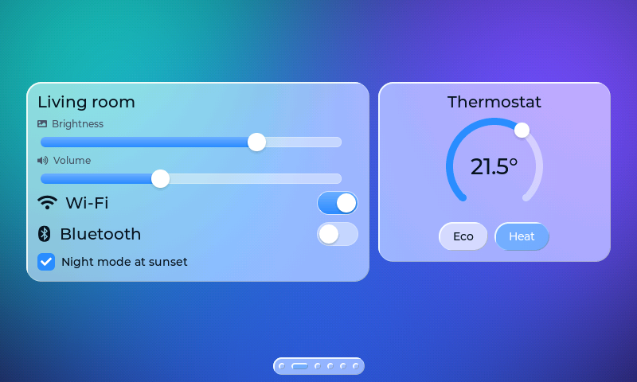

## Why it is fast enough for an MCU

The blur is the costly part of a glass look, so GlassVGL does it once at start-up and keeps the
result. After that a glass panel costs one image copy, one translucent fill and two thin bevel
lines per frame. On a PC benchmark (LVGL 9.6, RGB565, one core of a 2.1 GHz Xeon), a full-screen
redraw of the controls screen at 800x480 took 1.2 ms with the glass on and 0.8 ms in FLAT mode with
the glass off. A microcontroller is much slower than this, so the demo's STATS screen measures the
same thing on your board.

## Screenshots of the LVGL glass theme

Every image was rendered by the theme's own code. Click a heading to open it.

<details>
<summary>Six demo screens at 800x480, light and dark</summary>

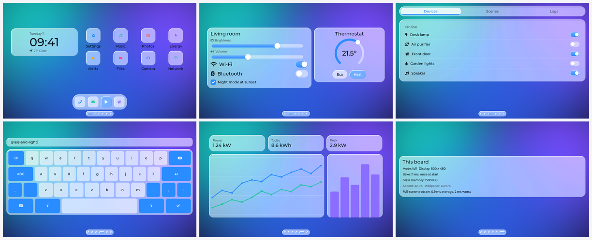

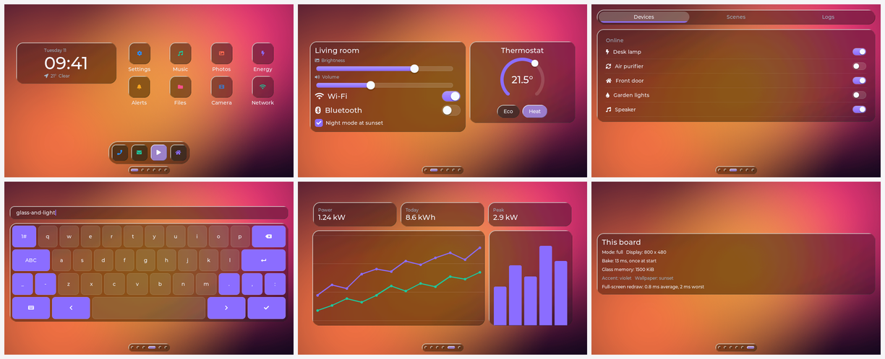

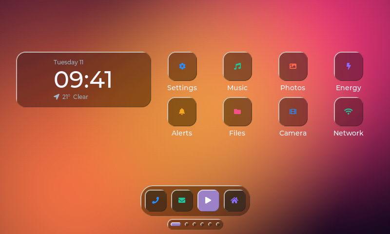

</details>

<details>
<summary>Small screens: 240x240 round and 320x240</summary>

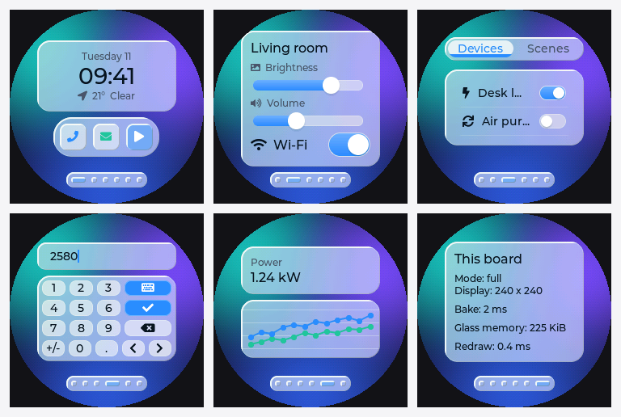

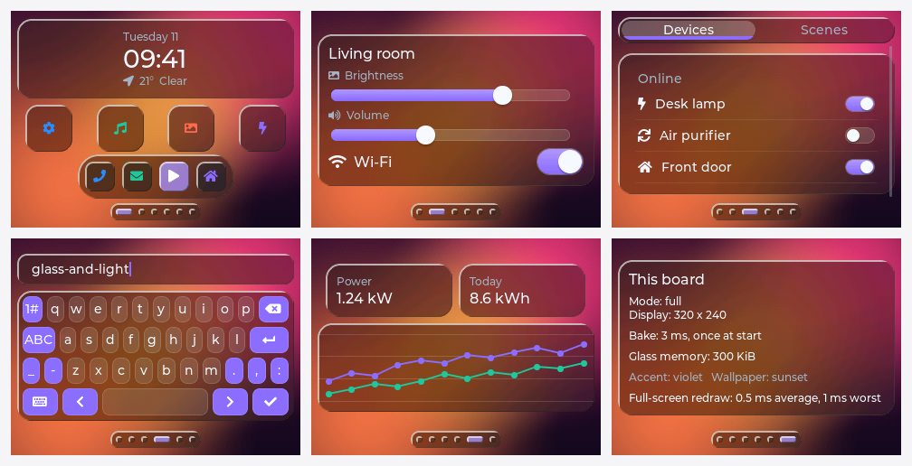

</details>

<details>
<summary>Accents, wallpapers and the three render modes</summary>

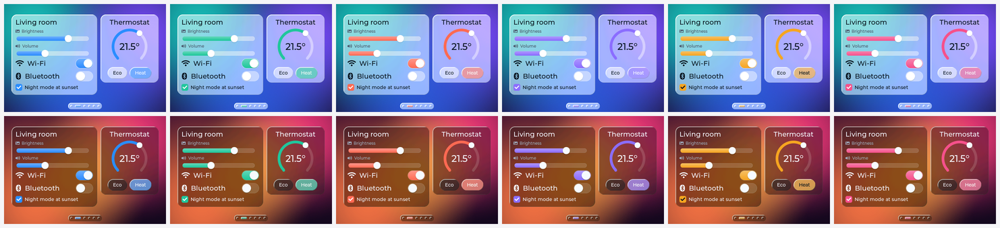

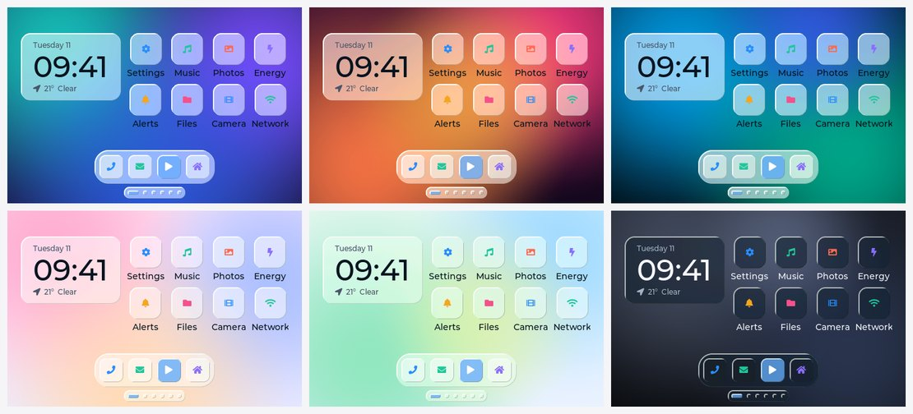

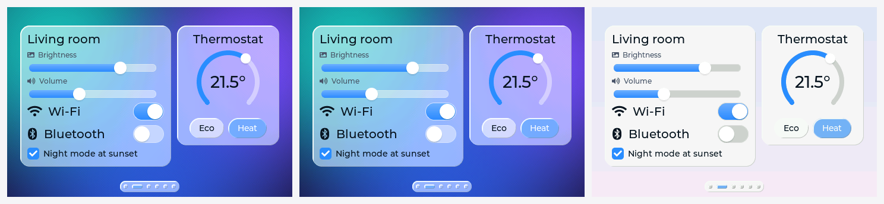

</details>

<details>
<summary>The 3D bevel, before and after</summary>

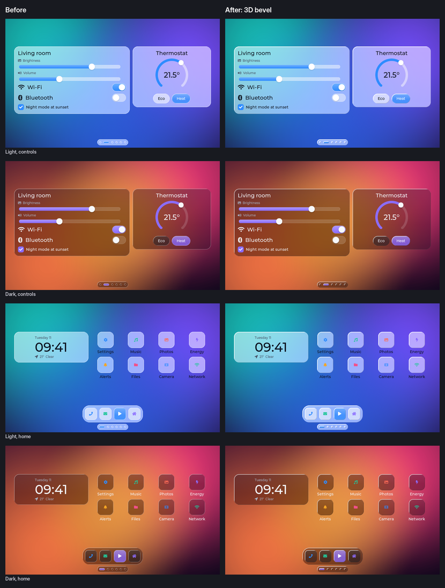

</details>

<details>
<summary>Swipe pager mid-swipe: live, snapshot and direct</summary>

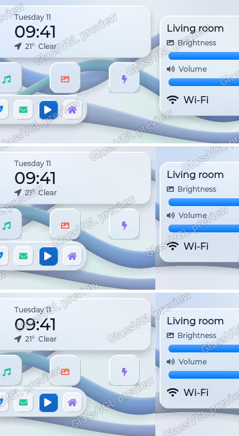

Top to bottom: live, snapshot, direct. In live mode the wallpaper stays still while the pages move.
In snapshot and direct mode each page carries its own copy of the wallpaper.

</details>

## Features

- **Schemes:** light and dark.
- **Accents:** azure, mint, coral, violet, amber and rose, plus any colour you pick.
- **Wallpapers:** aurora, sunset, ocean, blush, meadow and graphite, drawn in code so they cost no image flash, or your own image.
- **Render modes:** FULL for boards with PSRAM, LITE for boards without it, FLAT when RAM is very short. AUTO picks one from the memory it finds.
- **Widget variants:** panel, accent or clear glass, or a plain solid fill, set per widget.
- **Swipe pager:** slides pictures of the pages instead of redrawing every widget, when the RAM allows.
- **Demo:** six screens (home, controls, lists, keyboard, dashboard, stats) that fit any size from 240x240 round to 1024x600.

It works with LVGL 9.3 to 9.6, in RGB565, RGB565_SWAPPED, RGB888 and XRGB8888.

## Sample projects for every LVGL toolchain

| Folder | Toolchain | What it shows |
|---|---|---|
| `examples/GlassVGLDemo` | Arduino IDE, arduino-cli | The six demo screens on any board |
| `examples/GlassVGLPager` | Arduino IDE, arduino-cli | Four demo screens in the swipe pager, with touch |
| `examples/platformio` | PlatformIO | The demo for ESP32-S3, ESP32, ESP32-C3, Raspberry Pi Pico and STM32F429 Discovery |
| `examples/platformio-native` | PlatformIO | The demo on your PC, no board needed |
| `examples/esp-idf` | ESP-IDF 5 | The demo with PSRAM switched on |
| `examples/zephyr` | Zephyr | The demo with GlassVGL as a Zephyr module |
| `examples/desktop` | CMake or make | The demo on your PC, writing a picture of the home screen |

The Arduino, PlatformIO and ESP-IDF board samples have one function to fill in, `panel_push()`,
which sends a block of pixels to your display with whatever driver you already use. The pager
sketch also has `touch_read()`. The Zephyr sample uses the display in your board's devicetree.

## Quick start: Arduino, PlatformIO, ESP-IDF, Zephyr, CMake

Put your copy of GlassVGL Pro next to this repository, so the two folders sit side by side as
`GlassVGL` and `GlassVGL-Pro`. The samples look for it there. You also need LVGL 9.3 or newer.

**Arduino IDE.** Add GlassVGL Pro with Sketch > Include Library > Add .ZIP Library, and install
LVGL 9 from the Library Manager. Put an `lv_conf.h` beside the lvgl library folder, as LVGL's
Arduino guide says (`examples/platformio/include/lv_conf.h` works). Then open
`examples/GlassVGLDemo/GlassVGLDemo.ino`.

**PlatformIO.**

```sh
cd examples/platformio-native && pio run -t exec    # on your PC
cd examples/platformio && pio run -e esp32s3         # or esp32, esp32c3, pico, stm32f429
```

**ESP-IDF.**

```sh
cd examples/esp-idf && idf.py set-target esp32s3 && idf.py build
```

**Zephyr.** From your west workspace:

```sh
west build -b native_sim/native/64 path/to/GlassVGL/examples/zephyr
```

**CMake or make.**

```sh
cd examples/desktop
cmake -S . -B build -DLVGL_DIR=/path/to/lvgl && cmake --build build && ./build/glassvgl_desktop
make LVGL_PATH=/path/to/lvgl && ./glassvgl_desktop
```

If GlassVGL Pro lives somewhere else, point the sample at it: `-DGLASSVGL_DIR=...` for CMake and
Zephyr, `GLASSVGL_DIR=...` for make, the `symlink://` line in `platformio.ini`, or the `path:` line
in `examples/esp-idf/main/idf_component.yml`.

The theme starts with one call after you create the display:

```c
lv_glass_config_t cfg;
lv_glass_config_init(&cfg);
cfg.scheme = LV_GLASS_SCHEME_DARK;
cfg.accent = LV_GLASS_ACCENT_AZURE;
lv_glass_theme_init(disp, &cfg);
```

## What has been tested

With GlassVGL Pro beside them, these samples were built on a Linux PC by each toolchain's own tool:
the desktop sample with CMake and with make against LVGL 9.3.0 and 9.6.0, `platformio-native` with
PlatformIO 6.2, `zephyr` on Zephyr's `native_sim/native/64` board, and both Arduino sketches with
arduino-cli 1.3.1 for the Raspberry Pi Pico. The ESP-IDF sample, the ESP32 builds and the boards in
`examples/platformio` were not built, and nothing has run on real hardware yet.

## Licence

The sample code and configuration files are under the MIT licence in [LICENSE](LICENSE). The
GlassVGL name and logo are not covered by it. The GlassVGL Pro pack the samples build against has
its own paid licence and is not in this repository. Third-party credits are in
[THIRD_PARTY_NOTICES.md](THIRD_PARTY_NOTICES.md).

The look was inspired by Kyant0's [AndroidLiquidGlass](https://github.com/Kyant0/AndroidLiquidGlass)
(Apache-2.0). No code from it is used.
